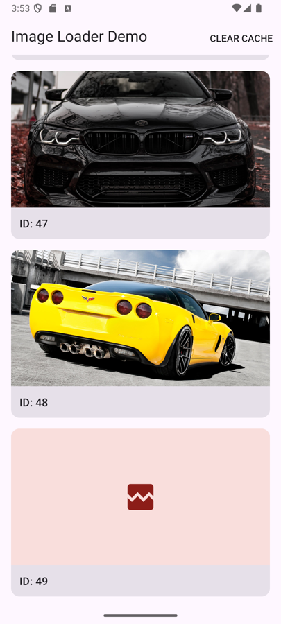

# Image Loader

An Android image downloading and caching library with **no third-party dependencies** (Kotlin Coroutines, `HttpURLConnection`, memory + disk cache with a 4-hour TTL, manual invalidation), plus a sample app (Android Views, MVVM) that lists images from a remote JSON.



## Requirements checklist

| Requirement | Where |
|---|---|
| Input: URL, placeholder (resource or `Drawable`), target `ImageView` | `ImageLoader.load(url)` → `ImageRequest.placeholder(...)` → `into(imageView)` |
| Cached image valid for 4 hours | `DiskCache` TTL, configurable via `ImageLoader.Builder.cacheTtl` |
| Manual cache invalidation | `ImageLoader.invalidate()` / `invalidate(url)` |
| Kotlin Coroutines | `ImageLoader` internals; the app's ViewModel and data layer |
| Java and Kotlin callers | `ImageViewHolder.java` (Java), `ImageView.load(...)` extension (Kotlin) |
| Fetch JSON, list with image + id | `ImageListApi`, `ImageListAdapter`, `item_image.xml` |
| Button that invalidates the cache | Toolbar "Clear cache" → `ImageListViewModel.clearCache()` |
| Android Views, MVVM, Coroutines | `ui/` package: Activity → ViewModel (`StateFlow`) → Repository |

## How to run

Requirements: JDK 17 or newer (the minimum for Gradle 9 and AGP 9.4), Android Studio with AGP 9.4 support, a device or emulator with API 26+.

```bash
./gradlew installDebug          # build and install the sample app
./gradlew testDebugUnitTest     # run all unit tests (JVM, no device needed)
```

`adb logcat -s ImageLoader` shows where each image comes from (`MEMORY`, `DISK`, `NETWORK`, or `JOIN` for a shared download) and logs failures as warnings.

## Architecture

```
app
  MainActivity ── collects StateFlow ──▶ ImageListViewModel ──▶ ImageRepository ──▶ ImageListApi
      │                                         │                                  (HttpURLConnection +
      │                                         │                                   kotlinx.serialization)
      │                                         └──▶ ImageCacheCleaner ──▶ ImageLoader.invalidate()
      └─ ImageListAdapter ──▶ ImageViewHolder (Java) ──▶ ImageLoader.load(url)…into(view)

imageloader
  ImageLoader ──▶ ImageCache ──┬─ MemoryCache (LRU of decoded bitmaps)
       │                       └─ DiskCache   (original bytes + TTL)
       ├─ ImageDownloader (HttpURLConnection)
       └─ BitmapDecoder   (downsampling to view size)
```

- **Manual DI:** `ImageApp` owns `AppContainer`, which provides the repository, the `ImageLoader` and the cache cleaner.
- **UI state:** `Loading`, `Content(items, imagesVersion)` or `Error(message)` (with a Retry button), rendered with `repeatOnLifecycle(STARTED)`.
- **`ImageCacheCleaner`:** a small interface over `ImageLoader.invalidate(onComplete)`, so the ViewModel can be tested with a fake. When clearing finishes, the ViewModel bumps `imagesVersion`. The Activity then rebinds the list, so images reload behind their placeholders, and shows a Snackbar.

## Library usage

```kotlin
// Kotlin
imageView.load(url) {
    placeholder(R.drawable.placeholder)   // a Drawable works too
    error(R.drawable.error)
}
```

```java
// Java
ImageLoader loader = ImageLoader.getInstance(context);
loader.load(url).placeholder(R.drawable.placeholder).error(R.drawable.error).into(imageView);

loader.invalidate();                                       // clear everything
loader.invalidate(url);                                    // clear a single URL
loader.invalidate(() -> adapter.notifyDataSetChanged());   // callback on the main thread when done
```

```kotlin
// Custom configuration. Use one instance per disk cache directory.
val loader = ImageLoader.Builder(context)
    .cacheTtl(Duration.ofHours(1))                        // default: 4 hours
    .memoryCacheMaxBytes(32 * 1024 * 1024)                // default: 1/8 of max heap
    .diskCacheDirectory(File(context.cacheDir, "thumbs")) // default: cacheDir/image_cache
    .build()
```

## How a load works

`into(imageView)` runs on the main thread:

1. Cancel the request previously bound to this view. The adapter also cancels it in `onViewRecycled`.
2. If the view is already measured and the bitmap is in memory, set it right away (no placeholder flicker).
3. Otherwise show the placeholder, or clear the view, so a recycled cell never shows an old image.
4. Create the request coroutine lazily, store its `Job` in the view's tag, then start it.
5. Wait for the view's size (suspends until layout if needed).
6. Check memory, then disk, then the network on `Dispatchers.IO`. At most 4 downloads run in parallel, and concurrent loads of the same URL share one download.
7. Decode downsampled to the view size.
8. Set the bitmap only if the view's tag still points to this request; a late result for a recycled view is dropped. On failure show the error drawable, or keep the placeholder. Failures never crash.

All work runs in one loader scope (`SupervisorJob` + `Main.immediate` + `CoroutineExceptionHandler`). The public API has no `suspend` functions, so it works naturally from Java. Checked on an emulator by fast-scrolling through all 50 items: no image showed up in the wrong cell.

## Caching strategy

**Memory cache**
- An LRU of decoded `Bitmap`s, limited to 1/8 of the max heap and sized by `allocationByteCount`.
- The key is `url#WxH`, because a bitmap is decoded for a specific target size.

**Disk cache**
- Stores the original downloaded bytes in `cacheDir/image_cache`, one file per URL, named by SHA-256 of the URL.
- Writes go to a `.tmp` file first and are then renamed into place, so a half-written file is never read.
- Entries are valid for **4 hours** from when they were written, using the file's last-modified time. Expired entries are deleted when read and downloaded again.
- The clock is injectable, so the TTL is unit-tested with a fake clock.

**Invalidation and the race with in-flight loads**
- `invalidate()` clears memory immediately. The disk deletion is queued and runs on IO; `onComplete` is called on the main thread afterwards.
- The queued disk work also runs under a lock before *any* later disk read or write. So a load started right after `invalidate()` can never pick up a stale file.
- A download that started *before* `invalidate()` must not refill the cache afterwards. To prevent that, every invalidation increments a **generation counter**. Each request records the generation when it starts, and the cache rejects writes from an older generation. The result is still shown in the view, just not stored.

**In-flight deduplication**
- Concurrent loads of the same URL share one download, keyed by (URL, generation). A load started after an invalidation never joins an older download.
- The shared download runs in the loader's scope, so it keeps going if one of the views waiting for it is recycled.

## Testing

All tests run on the JVM (`./gradlew testDebugUnitTest`):

- `DiskCacheTest`: 4 h TTL boundary (fresh vs. expired) with a fake clock.
- `ImageCacheTest`: invalidation clears memory and disk, including rejecting stale-generation writes (the invalidate race).
- `BitmapDecoderTest`: `inSampleSize` calculation.
- `ImageListApiParsingTest`: JSON `imageUrl` → `url` mapping.
- `ImageListViewModelTest`: Loading / Content / Error states, retry, cache clear bumps `imagesVersion`.

`MemoryCache` and `ImageCache` are generic over the value type, so they're tested with strings instead of real bitmaps. `ImageLoader` itself (views, bitmaps, main thread) and the UI aren't unit-tested. They would need Robolectric or instrumented tests, which were left out of scope; the behaviour was checked manually on an emulator.

## Notes on the data

The JSON items look like `{ "id": 0, "imageUrl": "..." }`, and `imageUrl` is mapped to `ImageItem.url`. 5 of the 45 unique image URLs return **HTTP 403**, which shows the error drawable. 5 URLs appear twice (for example ids 17 and 18), which exercises in-flight deduplication.

## Trade-offs

- **TTL via file timestamps:** simple, with no metadata files, but it depends on the file system's timestamp precision. That's fine on ext4/f2fs.
- **No disk size limit:** the 4 h TTL and Android's own cache-dir trimming keep it bounded in practice.
- **Size in memory keys:** the same URL shown at two sizes is stored twice in memory, in exchange for always decoding to the right size.
- **`invalidate(url)` bumps the global generation:** in-flight results for *other* URLs aren't cached either. It's simpler and always correct, at the cost of a few extra downloads after a rare operation.
- **Shared downloads aren't cancelled when their last waiter cancels:** the result still lands in the disk cache, which helps when the user scrolls back.
- **No lifecycle-aware cancellation:** requests are cancelled on rebind and recycle, not on Activity destroy or view detach. Downloads are short and bounded by timeouts.
- **`HttpURLConnection` instead of OkHttp:** keeps the library dependency-free, at the cost of no HTTP/2, interceptors or fine-grained connection pool configuration.

## Future improvements

- Lifecycle- and detach-aware cancellation (cancel requests when the `LifecycleOwner` is destroyed).
- Disk cache size cap with LRU trimming, and cleanup of leftover `.tmp` files on startup.
- Respect HTTP caching headers (`ETag`, `Cache-Control`) instead of only a fixed TTL.
- Bitmap reuse (`inBitmap`) and hardware bitmaps. `ImageDecoder` on API 28+.
- Transformations (rounded corners, crossfade), success/error listeners.
- Prefetching, request priorities, retry with backoff for transient network errors.
- Robolectric or instrumented tests for `ImageLoader` and the UI.
- Publish the library as an AAR / Maven artifact with explicit API mode.
